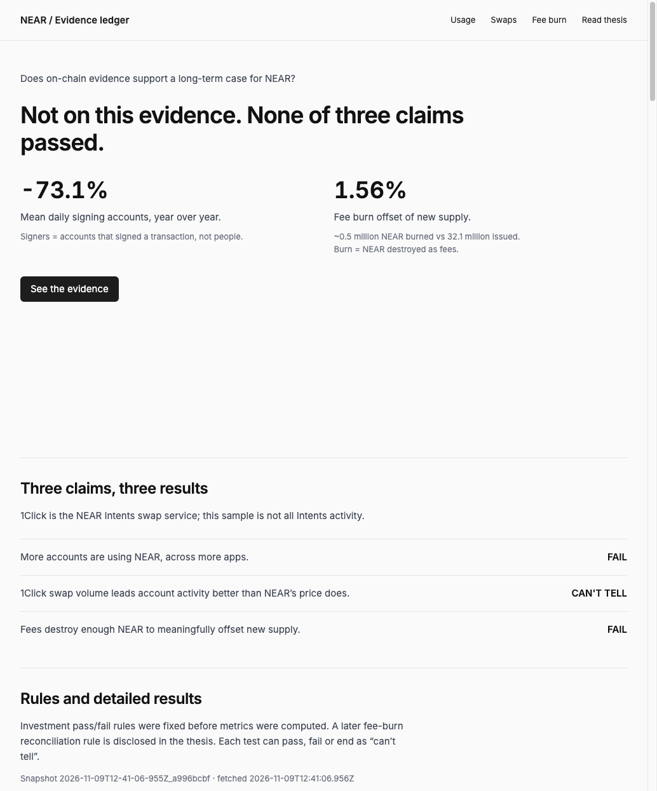
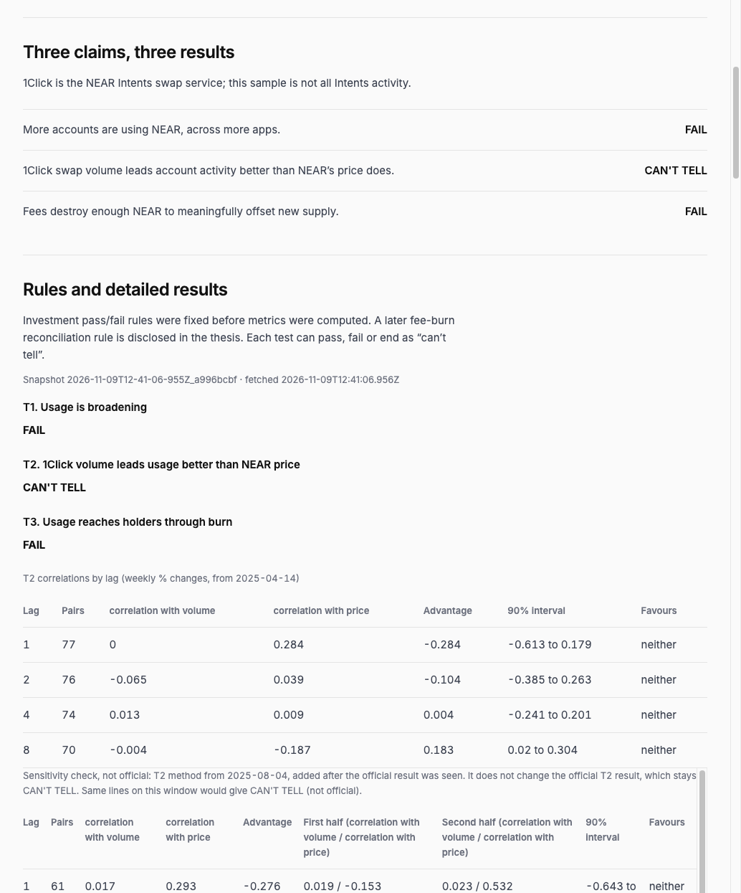
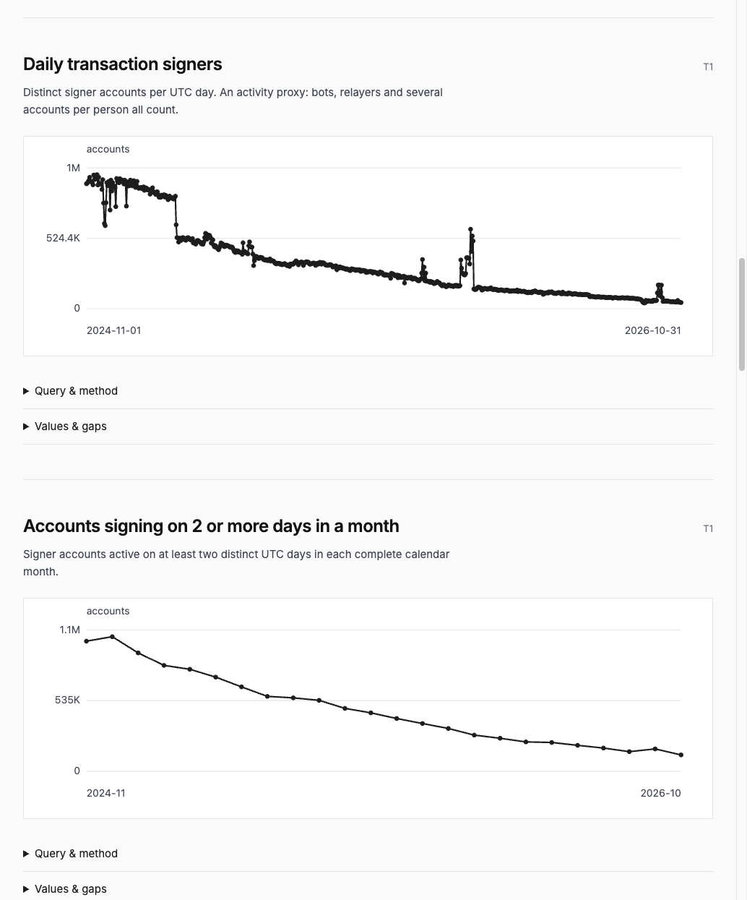
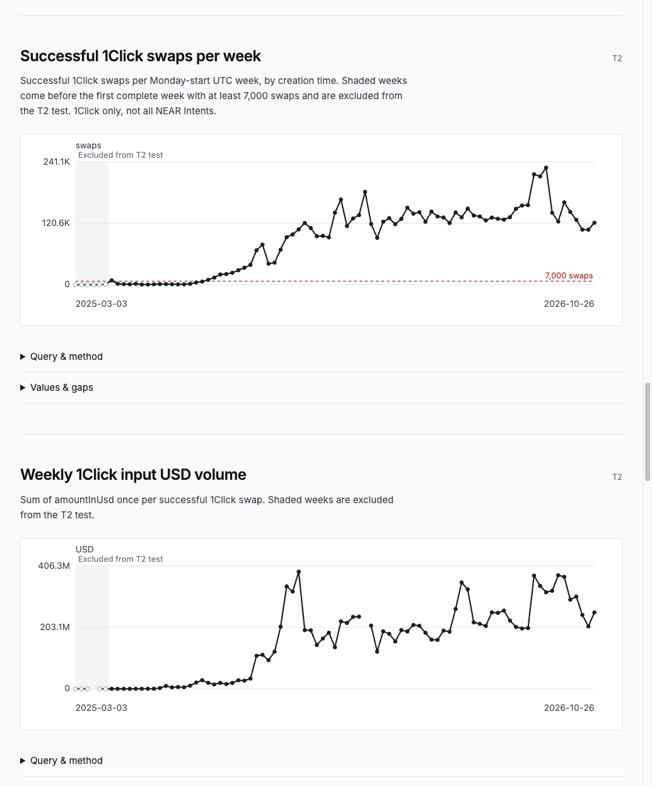
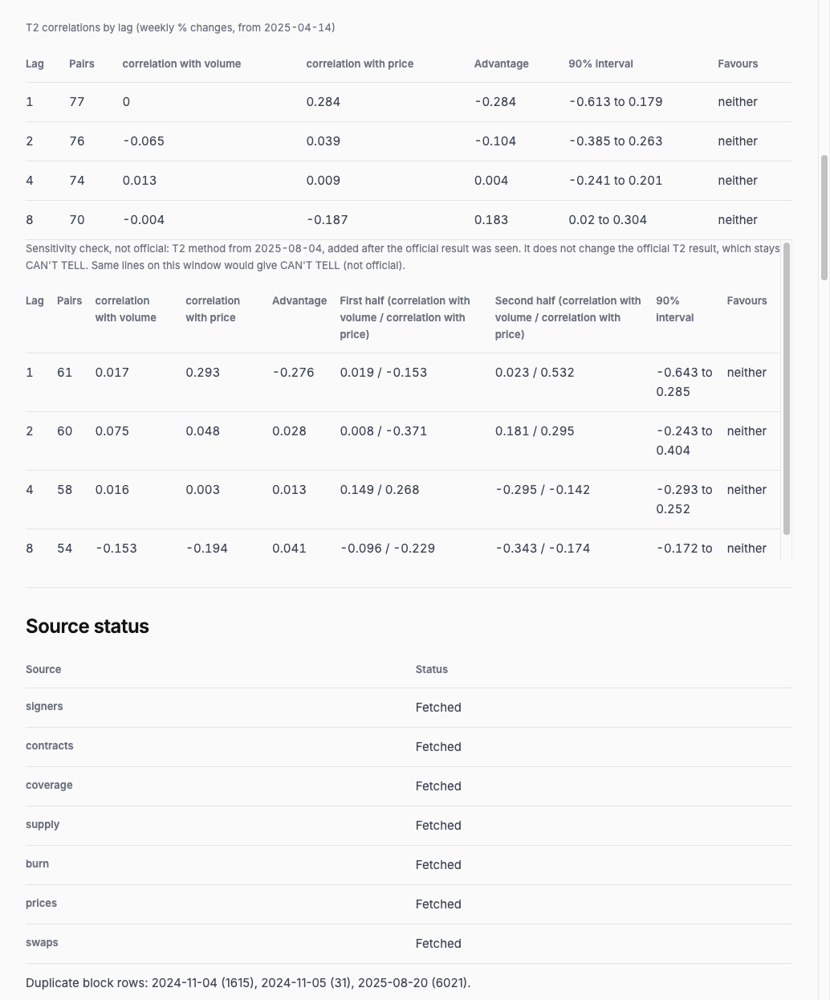
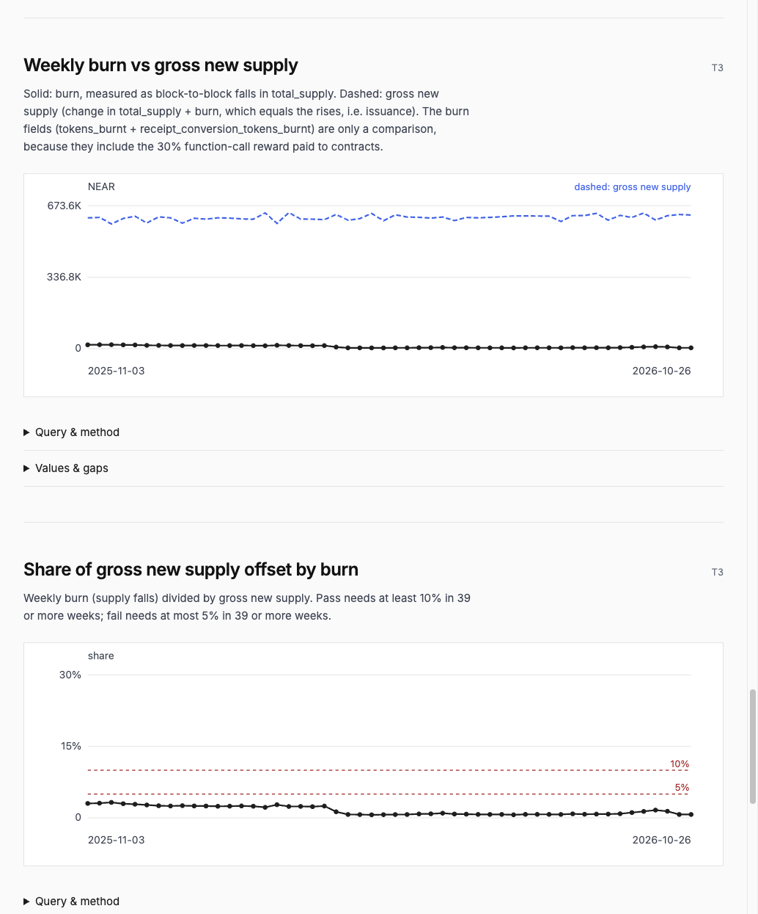
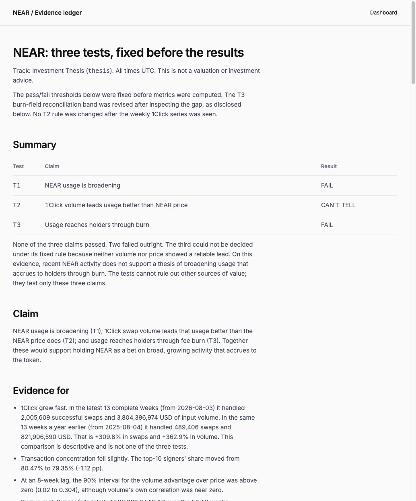

# NEAR / Evidence ledger

We tested three reasons to own NEAR against public chain data and 7,509,299 real swaps, and none of them passed.

Mean daily signing accounts fell **73.1% year over year**. Fee burn offset **1.56% of new supply**, about **0.5 million NEAR burned versus 32.1 million issued**. Signers are accounts that signed a transaction, not people; burn is NEAR destroyed as fees.

| Claim | Result |
|---|---|
| More accounts are using NEAR, across more apps (T1). | **FAIL** |
| 1Click swap volume leads account activity better than NEAR’s price does (T2). | **CAN'T TELL** |
| Fees destroy enough NEAR to meaningfully offset new supply (T3). | **FAIL** |

The investment pass/fail rules were fixed before metrics were computed. A later T3 reconciliation rule is disclosed in `THESIS.md`; it was not pre-registered.

## Problem and project

Growing activity and swap volume do not automatically make a long-term case for owning a token. This project checks whether NEAR usage is broadening, whether swaps lead that usage better than price, and whether fees offset new supply.

Built for **NEAR Hackathon, Investment Thesis (`thesis`)**, the project is an offline-reproducible research pipeline, static dashboard and hand-written thesis. BigQuery NEAR mainnet tables provide account activity and supply changes; 1Click, the NEAR Intents swap service, provides observed swaps; Coinbase provides the price comparison. The swap data is **1Click only**, not all NEAR Intents activity.

The dashboard exposes every chart, value table and query. `THESIS.md` gives the rules, limits and what would change the conclusion. No price target or trading recommendation is implied.

## Try it (offline, no credentials)

Requires Node.js 22 or newer. No npm dependencies, no install step.

1. Run `npm test`. You should see 45 passing tests, including synthetic rule fixtures and checks of the committed public snapshot.
2. Run `npm run rebuild`. This rebuilds charts and number tables in `dashboard/` from `data/public/`, with no credentials or network access. It verifies, but never overwrites, `THESIS.md`. The last line prints the T1, T2 and T3 results.
3. Run `open dashboard/index.html` on macOS, or open that file in any browser. You'll see the conclusion and two headline numbers; click **See the evidence** to reach the first chart, with its query and expandable values table. The thesis link opens `dashboard/thesis.html`, a readable page generated from `THESIS.md` during rebuild, with the metric tags removed.

The committed BigQuery aggregates, price candles and daily 1Click totals reproduce all three results on a fresh clone: T1 FAIL, T2 CAN'T TELL, T3 FAIL. `data/raw/` and `.env` are not needed for rebuild.

`dashboard/NUMBERS.md` is generated. `THESIS.md` is not. If the evidence table or a `<!-- metric:key -->value<!-- /metric -->` claim in the thesis differs from public data, rebuild exits nonzero. Review the generated table, update the thesis by hand, and rerun. Keep all computed claims in the evidence table or tagged spans; dates, source facts and rule thresholds are separate. This is structured metric verification, not natural-language fact checking.

## Screenshots

Real browser captures of the final rebuilt dashboard and thesis, in reading order; each file is below 400 KB.



The dashboard leads with the conclusion, the signer decline and the fee-burn offset.



Plain-language claims show two failures and one undecided result before the technical details.



The signer chart shows observed daily account activity, with the query and exact values available below.



The weekly swap chart marks early weeks excluded by the fixed start rule.



The official correlations remain separate from the explicitly non-official sensitivity check.



Weekly fee burn stays small beside new supply, explaining the failed holder-value claim.



The generated thesis page presents the hand-written argument and its unchanged results.

## Reproduce from live sources

1. Copy `.env.example` to `.env` and set `GOOGLE_CLOUD_PROJECT` (a project that can run BigQuery jobs) and `NEAR_INTENTS_JWT` (from the [partner dashboard](https://partners.near-intents.org/)). Never commit `.env`.
2. Run `gcloud auth login`. The token is read locally with `gcloud auth print-access-token` and is never saved.
3. Run `npm run plan`. This is a free dry run. You'll see the bytes each query would scan, about 234 GB in total.
4. Run `npm run pull-swaps`. This pulls every successful 1Click swap from 2025-03-01 to 2026-11-02, at one request per 5.2 seconds. The completed pull here has 7,513 pages and 7,509,299 swaps, about 11 hours of requests. Each page is saved before the next request, so rerunning the command resumes from the last saved page. On macOS, `caffeinate -i npm run pull-swaps` keeps the machine awake.
5. After the pull finishes, run `npm run refresh`. This runs BigQuery jobs (or reuses cached results), fetches prices, exports public aggregates and attempts a rebuild. It exits nonzero if a source is unavailable or the hand-written thesis is stale. Review `dashboard/NUMBERS.md`, update the thesis by hand and run `npm run rebuild`.

To export already saved data without network calls, run `npm run export-public`. This does not read swap pages. After the pull finishes, run `npm run export-public -- --swaps` to include exact daily 1Click totals. Do not refresh or export swaps while the pull is running.

Refresh reuses a saved BigQuery result when its SQL text and literal date window match. `npm run refresh -- --rescan` forces new jobs. `MAX_BYTES_BILLED` (default 300 GB) caps one refresh. Separately, a ledger in `data/raw/bigquery/ledger.json` refuses any run that would push cumulative billed scans past 1 TB.

## Source-tool features used

- **BigQuery literal `block_date` filters:** partition-scoped queries plus dry runs and cached results kept cumulative billed scans to **242.87 GB**.
- **BigQuery `transactions` and `blocks` tables:** signer counts test account activity, while linked block `total_supply` changes measure fee burn against new issuance.
- **1Click Explorer API status and timestamp filters:** `statuses=SUCCESS` selects successful swaps and bounded timestamp paging retrieves the **7,509,299** observed swaps without losing reused deposit addresses.

These are the concrete source-tool features used, not additional mandatory sponsor integrations (Q-011).

## Queries

All queries read `bigquery-public-data.crypto_near_mainnet_us`, in location `us-east1`. Jobs sent to the `US` multi-region fail with 403.

| File | Table | Literal `block_date` filter | Output |
|---|---|---|---|
| `sql/signers.sql` | `transactions` | 2024-11-01 to 2026-11-02 | Daily signers; monthly accounts active on 2+ days; per-period top-10 signer transactions |
| `sql/contracts.sql` | `receipt_actions` | 104 listed Mondays, 2024-11-04 to 2026-10-26 | Distinct `FUNCTION_CALL` receivers per sampled day (**one-day-a-week sample**) |
| `sql/coverage.sql` | `blocks` | 2024-11-01 to 2026-11-02 | Daily block counts, duplicate rows, first and last timestamps |
| `sql/supply.sql` | `blocks` | 2025-11-03 to 2026-11-02 | Weekly falls and rises in `total_supply`, blocks linked by `prev_block_hash` |
| `sql/burn.sql` | `execution_outcomes`, `transactions` | 2025-11-03 to 2026-11-02 | Weekly `tokens_burnt` + `receipt_conversion_tokens_burnt` |

End dates are excluded. Every table read must be followed directly by a literal `block_date` range or date list. `scripts/sources.mjs` (`literalDateFilters`) enforces this before any request, and `tests/sources.test.mjs` checks every SQL file plus known bad patterns, including an unfiltered `MIN(block_date)`.

Other sources:
- **1Click Explorer:** `GET https://explorer.near-intents.org/api/v0/transactions` with `statuses=SUCCESS`, `showTestTxs=false`, `minUsdPrice=0`. After each page, set the exclusive `endTimestamp` to its oldest `createdAt` plus 1 ms. Resume from the last saved row, including old address-cursor pages. Skip known swaps only at that boundary timestamp. Stop at an empty response or a short response with no new rows; a full 1,000-row response with no new rows is an error.
- **NEAR/USD price:** Coinbase Exchange public candles, `https://api.exchange.coinbase.com/products/NEAR-USD/candles` (free, no key), daily UTC closes.

## Files

```text
sql/                    Literal-date GoogleSQL queries
scripts/sources.mjs     BigQuery runner (guard, dry runs, budget, cache, ledger), prices
scripts/swaps.mjs       Resumable 1Click pull; scripts/pull-swaps.mjs is its CLI
scripts/report.mjs      Validation, T1/T2/T3 tests, charts, number tables and thesis verification
scripts/public.mjs      Private-to-public aggregate exporter
scripts/run.mjs         build | refresh [--rescan] | export [--swaps] | plan
data/raw/               Private local raw data (ignored by Git): BigQuery cache, swap pages, run manifests
data/public/            Committed aggregate evidence with SHA-256 manifest, no wallet fields
dashboard/              Public-safe static output
THESIS.md               Hand-written rules and interpretation with verified metrics
tests/                  Synthetic rules plus public-snapshot and offline CLI checks
```

Raw swap pages contain deposit addresses for deduplication and stay in ignored `data/raw/`. Addresses can repeat: swap identity is `depositAddress` + `depositMemo` (null when absent) + `createdAt`. True duplicates and broken timestamp continuity stop the pull. Public evidence contains BigQuery aggregate rows, daily closes, and daily swap counts with exact USD totals. No deposit addresses, memos, recipients or transaction hashes are exported.

## Hackathon notes

Built during the hackathon window with Node.js standard libraries only. No third-party template or earlier project code. AI code (Q-005): the code was written with Factory Droid and overseen by Claude Code. No deployment, transaction, repository publication or submission has been made. Before submitting, re-read the live `HACKATHON.md` and confirm the payload with the team.

License: MIT. See `LICENSE`.
